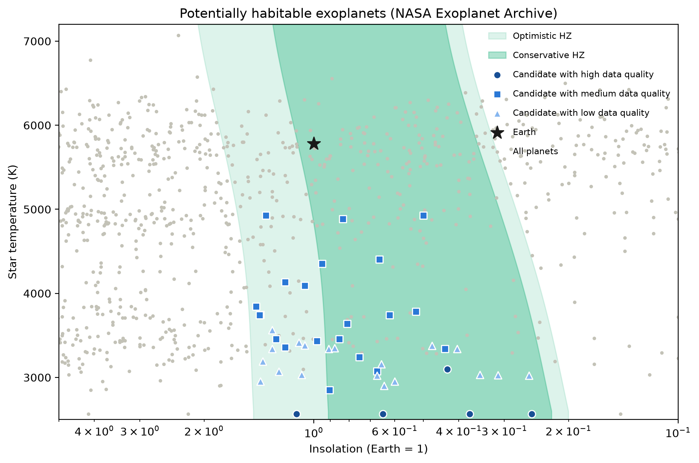
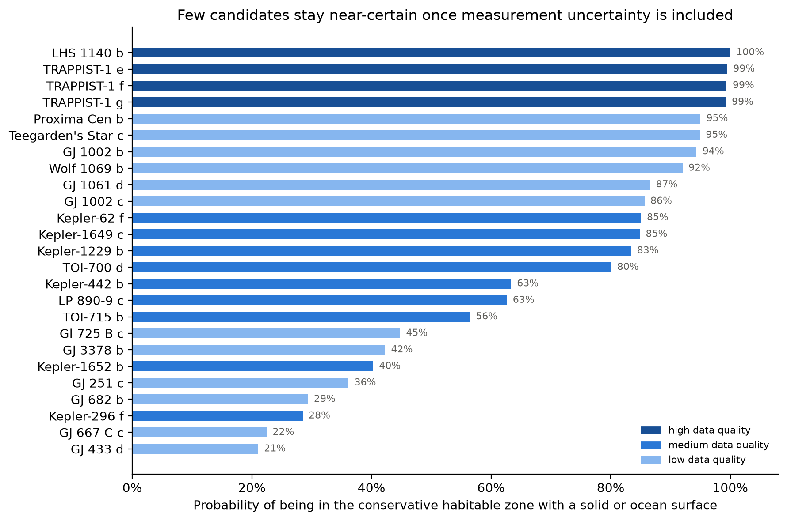
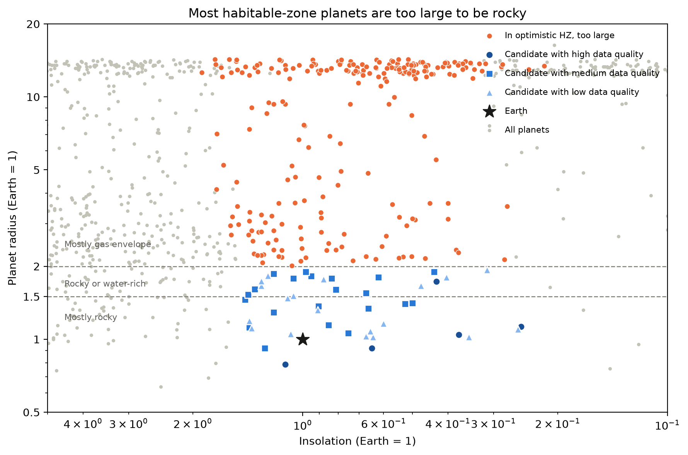
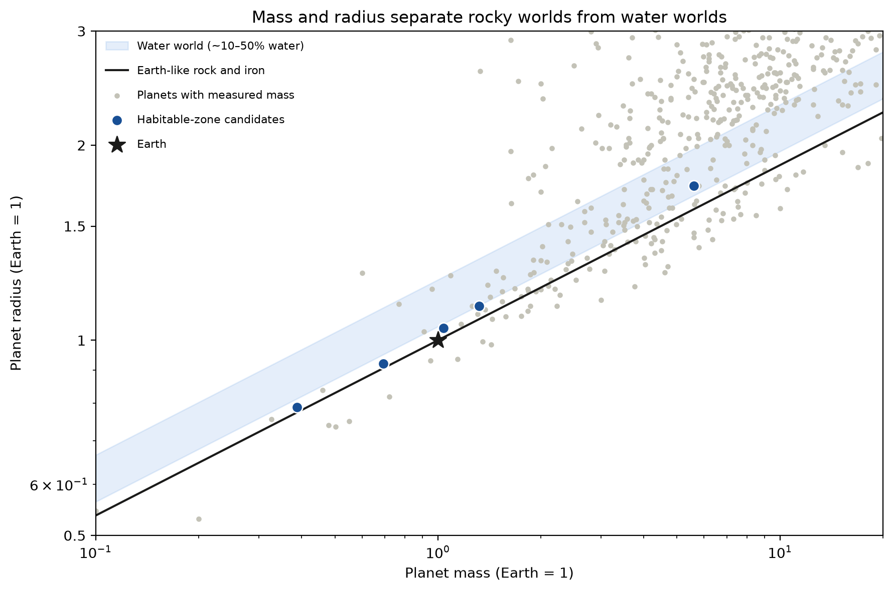

# Habitable Exoplanet Analyzer

Finds the confirmed exoplanets most likely to support liquid surface water, using live NASA data, published climate-model physics, and an honest account of how reliable each measurement is.



**[Live dashboard](https://luaie-habitable-exoplanet-analyzer-app-okvdqz.streamlit.app/)**: explore every candidate interactively.
Data, charts and the dashboard update automatically every Monday with the latest NASA archive data.

## How to Run

1. Clone the repo and open the folder in a terminal
2. Install dependencies: `pip install -r requirements.txt`
3. Run the pipeline in order:

```bash
python fetch_data.py    # download + clean NASA data
python habitable.py     # classify candidates
python monte_carlo.py   # simulate measurement uncertainty
python plots.py         # generate the charts
```

Run the tests with `pytest`, or launch the dashboard locally with `streamlit run app.py`.

Results are saved to `data/planets_mc.csv`. To pull fresh data from NASA, delete `data/planets_raw.csv` and rerun.

## How It Works

The pipeline downloads every confirmed exoplanet from the NASA Exoplanet Archive and runs each one through three tests:

1. **Habitable zone:** is the planet receiving the right amount of starlight for liquid water, given its star's temperature? Uses the Kopparapu et al. (2014) climate-model limits.
2. **Solid or ocean surface:** is it rocky or a water world, rather than wrapped in thick gas? Where mass and radius are both measured, the planet's density is compared with rock and water models from Zeng et al. (2016); otherwise its radius is used, following Rogers (2015).
3. **Atmosphere retention:** is its gravity strong enough to hold an atmosphere against its star's energy? Uses a simplified "cosmic shoreline" score after Zahnle & Catling (2017).

Planets that pass the first two tests become **candidates**, and every result is tagged with a **data-quality tier**, so measured values are never confused with estimates.

Each planet is then simulated **10,000 times** with values drawn from within its measurement error bars. The share of simulations that pass the tests becomes a **probability**, showing how confident each result really is.

## Results

_November 2026 archive snapshot. Numbers update as NASA adds planets._

| Metric                                                       | Result    |
| ------------------------------------------------------------ | --------- |
| Planets analysed                                             | 6,406     |
| In the optimistic habitable zone                             | 284       |
| Rocky habitable-zone candidates                              | **45**    |
| Candidates in the conservative zone                          | 27        |
| At least 50% likely to be in the conservative zone with a solid or ocean surface | 17 |
| At least 90% likely to be in the conservative zone with a solid or ocean surface | **8** |
| Well-known candidates recovered                              | **8 / 8** |
| Candidates with mass _and_ radius measured                   | 5         |

**Key findings**

- **Only 8 planets are near-certain once measurement uncertainty is included.** The 45 candidates range from near-certain down to coin flips.
- **LHS 1140 b is the strongest candidate, as a likely water world rather than an Earth-like rocky planet.** It is too large for Earth-like rock at its measured mass, which matches the 2024 finding that it is probably 10–20% water.
- **Most habitable-zone planets are too large to be rocky:** only 45 of 284 pass the size test.
- **Nearly every candidate orbits a cool red dwarf.** This is largely detection bias: red dwarfs' habitable zones are close in, so planets there are easier to detect.
- **Many "rocky" labels rest on estimates.** For 19 candidates, the radius was never observed.







### Strongest Candidates

Probability of being in the conservative habitable zone with a solid or ocean surface, alongside the probability of being Earth-like rock specifically.

| Planet             | Probability | Earth-like rocky | Composition | Radius (Earth = 1) | Starlight (Earth = 1) | Star Temp (K) | Data Quality |
| ------------------ | ----------- | ---------------- | ----------- | ------------------ | --------------------- | ------------- | ------------ |
| LHS 1140 b         | 100%        | 3%               | Water world | 1.73               | 0.43                  | 3096          | High         |
| TRAPPIST-1 e       | 99%         | 98%              | Rocky       | 0.92               | 0.65                  | 2566          | High         |
| TRAPPIST-1 f       | 99%         | 85%              | Rocky       | 1.04               | 0.37                  | 2566          | High         |
| TRAPPIST-1 g       | 99%         | 58%              | Rocky       | 1.13               | 0.25                  | 2566          | High         |
| Proxima Cen b      | 95%         | 95%              | Unknown     | 1.02               | 0.64                  | 2900          | Low          |
| Teegarden's Star c | 95%         | 95%              | Unknown     | 1.02               | 0.35                  | 3034          | Low          |
| GJ 1002 b          | 94%         | 94%              | Unknown     | 1.03               | 0.67                  | 3024          | Low          |
| Wolf 1069 b        | 92%         | 92%              | Unknown     | 1.08               | 0.65                  | 3158          | Low          |

## Classifications

**Habitable zone**

| Zone         | Inner edge         | Outer edge         |
| ------------ | ------------------ | ------------------ |
| Conservative | Runaway greenhouse | Maximum greenhouse |
| Optimistic   | Recent Venus       | Early Mars         |

**Planet type**

| Type      | Radius (Earth = 1)           |
| --------- | ---------------------------- |
| Rocky     | below 1.5                    |
| Uncertain | 1.5 – 2.0 (the "radius gap") |
| Gaseous   | above 2.0                    |

**Composition** (planets with measured mass and radius)

| Composition  | Radius compared with Earth-like rock of the same mass |
| ------------ | ----------------------------------------------------- |
| Rocky        | up to 5% larger (under ~10% water)                    |
| Water world  | 5–24% larger (~10–50% water)                          |
| Gas envelope | more than 24% larger                                  |

**Data quality**

| Tier   | What was measured                                       | Candidates |
| ------ | ------------------------------------------------------- | ---------- |
| High   | Mass and radius                                         | 5          |
| Medium | Radius only (mass estimated, or only an upper limit)    | 21         |
| Low    | Radius estimated, not observed                          | 19         |

## Files

```
habitable-exoplanet-analyzer/
├── fetch_data.py             — Downloads, caches and cleans NASA data
├── habitable.py              — Habitable zone, planet type, data quality, atmosphere score
├── monte_carlo.py            — Simulates measurement uncertainty, outputs probabilities
├── plots.py                  — Generates the charts
├── app.py                    — Interactive Streamlit dashboard
├── test_pipeline.py          — Automated tests (pytest)
├── results/planets_mc.csv    — Results used by the dashboard
├── .github/workflows/        — Weekly automated data update
├── hz_diagram.png            — Habitable zone chart
├── radius_diagram.png        — Planet size chart
├── mass_radius_diagram.png   — Composition from mass and radius
├── probability_ranking.png   — Top candidates by probability
├── requirements.txt          — Python dependencies
├── README.md
└── data/                     — Generated CSVs (not committed; recreated by the scripts)
```

## Technical Notes

- Data comes from the archive's **Planetary Systems Composite Parameters** table via its TAP API, with one row per planet and the best available values
- **Gaps are filled with physics, not dropped:** missing orbital distances come from Kepler's third law, and missing starlight from stellar luminosity, recovering 760 values. Every calculated value is flagged
- **Validated against known candidates:** the method recovers all 8 well-known habitable-zone planets tested
- **Cool-star edge case:** TRAPPIST-1 (2566 K) sits just below the Kopparapu formula's calibrated range (2600–7200 K). Slightly-out-of-range stars use the nearest calibrated value and are flagged. For TRAPPIST-1 this changes the zone edges by under 0.5% and reproduces the limits published by Gillon et al. (2017)
- **Missing error bars get honest defaults:** ±30% for estimated radii, ±10% for other values and ±100 K for star temperatures. Missing errors almost always mean an estimated value, so assuming zero error would make the least certain planets look the most certain
- **Monte Carlo checks:** probabilities agree with the yes/no classification for all 45 candidates (Kepler-440 b is a borderline 52%), shift by about 1 percentage point between random seeds, and fully measured planets are unaffected by the default uncertainties
- **A bug the checks caught:** quality tiers were first based on whether the _mass_ was measured, so radial-velocity planets with estimated radii (such as GJ 1061 d) were rated high quality, and GJ 1061 d ranked #1. Tiers now depend on whether the radius was actually observed
- **Composition from density:** where mass and radius are both measured, the radius is compared with an Earth-like rocky planet of the same mass (Zeng et al. 2016) to separate rocky planets, water worlds and gas envelopes. Water worlds count as having a habitable surface; mass is simulated alongside radius, so borderline planets get probabilities
- **The rocky boundary is a smooth transition, not a hard cutoff:** for planets without a measured mass, the chance of being rocky falls gradually with radius, reaching 50% at 1.6 Earth radii (Rogers 2015)
- **A second data catch:** many archive masses are only upper limits, flagged separately in the data. Treating them as measurements made physically impossible planets look rocky (Kepler-62 f at "35 Earth masses"). Limits are now excluded, which halved the number of planets classed as rocky by density
- **Automated weekly update:** a scheduled GitHub Actions workflow reruns the full pipeline and tests every Monday and commits the updated results; the live dashboard redeploys automatically
- Atmosphere scores are checked against the Solar System: Earth = 1.0, Mars ≈ 0.09

## Limitations

- Assumes Earth-like planets; different atmospheres, clouds or slow rotation can shift the zone edges
- The rocky transition was derived from short-period planets and may not transfer perfectly to cooler orbits
- Water worlds can only be identified for planets with measured mass; for the rest, a water-rich planet near 1.5–2 Earth radii is scored as probably not rocky
- The composition thresholds come from simplified rock and water models; real planets can mix iron, rock, water and gas in ways that produce the same density
- Planets with estimated radii depend on the assumed default uncertainties, so their probabilities are less reliable
- The atmosphere score ignores X-ray/UV radiation, which red dwarfs emit heavily, so real risk is likely higher for most candidates
- Magnetic fields, plate tectonics and actual atmospheres can't be assessed from this data
- Being in the habitable zone means liquid water is _possible_, not confirmed

## References

- Kopparapu et al. (2014), _Habitable Zones around Main-sequence Stars: Dependence on Planetary Mass_, ApJL 787, L29
- Rogers (2015), _Most 1.6 Earth-radius Planets are not Rocky_, ApJ 801, 41
- Zeng, Sasselov & Jacobsen (2016), _Mass–Radius Relation for Rocky Planets Based on PREM_, ApJ 819, 127
- Zahnle & Catling (2017), _The Cosmic Shoreline_, ApJ 843, 122
- Gillon et al. (2017), _Seven temperate terrestrial planets around the nearby ultracool dwarf star TRAPPIST-1_, Nature 542, 456
- Data: [NASA Exoplanet Archive](https://exoplanetarchive.ipac.caltech.edu/), operated by Caltech under contract with NASA

---

Built by Luai
